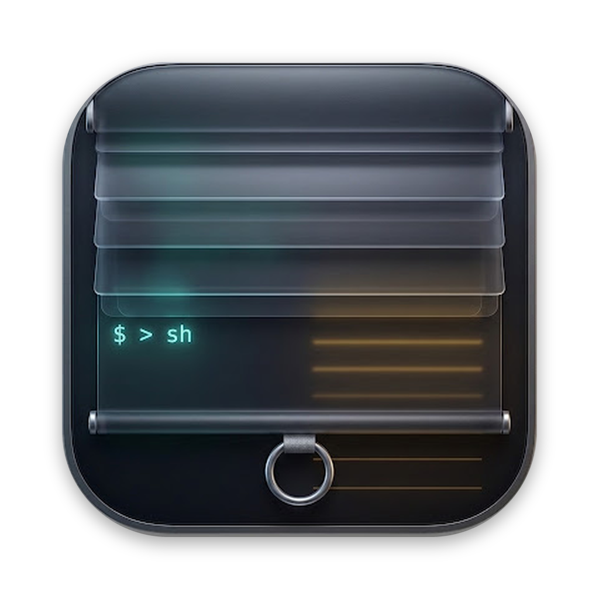

<p align="center"></p>

# Shade

**Your notes, terminals and code, one keystroke away, on top of every app.**


Shade is a small, native macOS app that pulls a translucent panel down from the top of your screen, like a
window shade. Press **⌃Space** in any app and your notes appear; press it again and they're gone. The app you're
in, your meeting or your IDE, stays in front the whole time.

Keep a card per meeting, read a live translation next to your notes, and run Claude Code, Copilot CLI or any
other command in a terminal card without switching windows: sandboxed, if you like, so an agent can only change
the project you give it.

<!-- Screenshots: docs/screenshots/*.png, added once captured. -->

## Why Shade

- **Always within reach.** One global shortcut, from any app, over full-screen apps and on every Space.
  There's no window to find, and it's gone again just as fast.
- **Doesn't get in the way.** The panel takes your typing without stealing focus from Teams, Zoom or your IDE.
  The background is see-through, so you can still see what's behind it.
- **Speak in another language with confidence.** Write your points in one language and read them in another,
  side by side. Translation runs on-device with Apple's Translation framework: free, no account, and your text
  never leaves your Mac.
- **More than notes.** Terminal cards run your shell right in the panel. Each card's tab shows the live status
  that tools like Claude Code and Copilot CLI write to the terminal title.
- **Let agents work, safely.** Sandboxed terminal cards keep an agent inside its project folder and away from your
  keys and credentials, while the sidebar shows every change it makes as it happens, and Agent Traffic shows
  what it sends over the network.
- **Native, small and private.** Swift, SwiftUI and AppKit, no Electron. No account, no analytics, no
  telemetry. Everything stays on your Mac.

## Features

### Notes that drop down
- **⌃Space** (configurable) shows and hides the panel from any app; **Esc** hides it too.
- **Window buttons** at the top left, like any Mac window: **red** hides the panel (your cards and terminals keep
  running), **yellow** rolls it up to just the toolbar and card tabs, like a window shade, and **green** fills the
  screen below the menu bar or restores your size. Click a card or press ⌃Space to roll it down again.
- **Cards** keep separate notes as tabs, for example one per meeting, talk or topic. **⌘T** adds one,
  **⌘1…⌘9** switches. Double-click a tab to rename it; otherwise it shows the card's first line.
- **Groups**, like Chrome's tab groups: right-click a card › *Add to New Group*. Each group gets its own color
  automatically and is named after the card's repository when it has one. Click the group's label to collapse or
  expand it, double-click to rename it, and right-click to change its color, ungroup it or close it. Cards you open
  from a grouped card (a new card, or a file from the sidebar) join its group, so a terminal and its files stay
  together.
- Everything is saved as you type and comes back after a restart.
- A larger or smaller font, adjustable background opacity, and a panel you can **resize** by dragging its bottom
  edge or corner. It stays centered under the menu bar.

### Live translation
- Turn on **Translate** to see a translation next to your notes, updated as you type and kept line by line so
  your structure stays intact.
- Choose the source language (or auto-detect) and the target language: German, English, French, Spanish,
  Italian, Dutch, Polish, Turkish, Portuguese, Hindi, Japanese and Chinese.
- Runs fully on-device. The 🌐 button can also open the text in Google Translate if you prefer it (that one does
  send the text to Google).

### Terminal cards
- **⇧⌘T** opens a terminal card with your own login shell, profile, aliases and tools.
- Each theme has its own 16-color terminal palette, tuned so the dim hints of tools like Copilot CLI and Claude Code
  stay readable, and cards tell command-line tools whether they're dark or light (`COLORFGBG`).
- **Minimum contrast**, like iTerm2's: text whose color is too close to its background, such as hints a tool
  colored for a light terminal, is brightened or darkened just enough to read, also after you switch themes.
- Each card has its own shell, which keeps running while the panel is hidden or you're on another card.
- The tab shows the title the running program sets, so you can follow Claude Code or Copilot CLI progress at a
  glance. A dot tells you a background card has new output.
- Closing a card or quitting the app asks first and names what would be stopped, for example
  *"Close terminal while “claude” is running?"*

### Sandboxed terminals for agents
Run Claude Code, Copilot CLI or any other tool in a **sandboxed terminal card** (the 🛡 button next to **+**). You
pick the project folder; everything started in that card, the agent and every command it runs, is confined by
macOS's built-in sandbox:
- **Project Only**: it can change files only in that folder, temp and tool caches (Gradle, npm, Kotlin/Native…) and
  the agents' own settings. Everything else on your Mac is read-only.
- **Keys and credentials are off limits**: `~/.ssh`, `~/.aws`, `~/.gnupg`, `~/.kube`, `~/.docker`, gcloud and GitHub
  CLI tokens, `.netrc`, `.npmrc`, `~/.gradle/gradle.properties` and similar can't be read at all.
- **No way out through files that run later**: folders on your `PATH` (`~/.local/bin`, `~/.cargo/bin`…), Gradle init
  scripts, git configuration and the project's `.git/hooks` and `.git/config`, and Claude Code's settings and
  `CLAUDE.md` can't be written, because they'd run outside the sandbox the next time you use them.
- **Strict (No Network)**: the same, plus no network except to your own Mac, for reviewing code without anything
  leaving it. An agent that needs its cloud API works only with **Record Agent Traffic** on: then programs can
  reach agent services such as Anthropic, OpenAI and GitHub Copilot through Shade, and nothing else.
- The tab shows a green shield, and **Blocked Actions** opens a live log of everything the sandbox denied.

Good to know: the sandbox is fixed when the card starts, so `cd`-ing elsewhere doesn't widen it. Things it blocks
on purpose: `git push` over SSH, installing with Homebrew, and builds that need secrets from
`~/.gradle/gradle.properties`; run those in a normal terminal card. It uses `sandbox-exec`, which Apple marks as
deprecated but still ships and which tools like Chrome and coding agents rely on. It's a strong safety net, not a
guarantee.

### See what agents send
Turn on **Record Agent Traffic** in the 🛡 menu before opening a terminal card, sandboxed or not. What programs in
that card send over the network shows up in an **Agent Traffic** card (the button in the card's bar, or **Agent
Traffic** in the menu bar icon):
- a list of calls with model or host, the program that made them, status, tokens or bytes and duration, filterable
  by card. **Agents** shows calls to model and agent services; **All** shows every connection;
- a **Summary** of each model call: the system prompt, the last user message, the reply, and the tools offered and
  used;
- the full **Request** and **Response** of model calls, pretty-printed and highlighted.

How it works: the card's programs are pointed at a small relay inside Shade on `127.0.0.1:18090`.
- **Model calls in full**: `ANTHROPIC_BASE_URL` and `OPENAI_BASE_URL` point to the relay, which forwards each call
  over normal HTTPS to `api.anthropic.com` or `api.openai.com` and keeps a copy, streaming replies straight
  through. Covered: Claude Code and other tools that use the Anthropic API, and tools that honor `OPENAI_BASE_URL`.
- **Every other connection, by host and size**: `HTTPS_PROXY` and `HTTP_PROXY` point to the relay too, which most
  tools follow (curl, git, npm, pip, Claude Code, GitHub Copilot CLI…). HTTPS stays encrypted between the program
  and the server, so Shade records the host, the program, how much went each way and how long it took, not the
  contents. That's how Copilot CLI shows up: its model calls go to GitHub with no address to point elsewhere.
  Nothing to install, no certificates.
- Shade tells which card and program made a connection by asking macOS which process has it open, like `lsof`.
- **Strict + Record Agent Traffic** is the auditable setup: the sandbox blocks every connection except to your
  Mac, so programs can only go out through Shade, and Shade lets them reach only agent services. Every call is
  listed, and blocked ones show as **BLOCKED**. Agent services are Anthropic, Claude, OpenAI, ChatGPT, GitHub
  Copilot (`githubcopilot.com`, `api.github.com`) and Gemini; add your own in ⚙︎ › **Agent Traffic**. (In this
  mode Shade also turns off Claude Code's non-essential traffic such as telemetry, which would be blocked anyway.)
- Tools that ignore the proxy settings connect directly and aren't recorded; in a Strict card they can't connect
  at all.
- If the relay can't start, the card doesn't start a shell, so nothing runs unrecorded.
- Recordings stay in memory: the last 100 model calls and 1,000 connections, until you click **Clear** or quit
  Shade. Model calls contain your code and prompts.

### See what your agent changed
When a terminal card's shell is inside a git repository, Shade notices and shows a slim repo bar: the
branch and how many files changed, updated as commands run. It's built for watching Claude Code or Copilot CLI
work without switching to your IDE.
- **Repository sidebar (⌘B)**, pinned on the left or right as you like, with two tabs: **Changes** (`git status`)
  and **Files** (a folder tree with a filter). It stays visible while you switch cards. Click a file to open it as
  a card; the sidebar highlights the file you're looking at.
- **File cards** are a lightweight editor: change the file and press **⌘S**. For a changed file, switch to its
  **diff** (green and red, read-only). They reload by themselves when the file changes on disk, so you can watch an
  agent edit it.
- **Safe next to an agent**: unsaved edits survive switching cards and hiding the panel (an orange dot marks
  them). If the file changes on disk while you're editing, you choose: load the disk version or keep yours. Saving
  over a newer version asks first, and closing or quitting with unsaved edits asks too.
- **Syntax highlighting** for about 190 languages, from Kotlin, Gradle, Java and Swift to XML, YAML, shell and
  even `Jenkinsfile` and Fastlane's `Fastfile`, detected from the file name (or picked in the card's header).
  Each Shade theme has its own highlighting theme; 16 come built in, including Android Studio, IntelliJ Light,
  Xcode, GitHub and Atom One. **Get More Themes** in ⚙︎ downloads any of the other highlight.js themes, much
  like installing a color scheme in Sublime Text, and you can add your own languages too.
- **Quick Open (⌘P)**: type part of a file name and open the file as a viewer card next to your notes.
- **Open in your editor**: one click hands a file or the whole repository to VS Code, Android Studio, Xcode or
  your default app (choose in ⚙︎ › Code).
- Files change only when you save. Git is read-only and runs without taking locks, so it can't get in the way of
  git commands running in the terminal. Binary, very large and non-UTF-8 files stay read-only, so their encoding
  can't be damaged.

### Make it yours
- **Themes:** Dark, Light, and Paper, a warm, yellowish tone that's easy on the eyes. Terminal cards follow
  the theme.
- **Hide from screen sharing** (on by default) keeps the panel out of most screen shares and recordings. It's
  best effort; see [Tips](#tips-and-troubleshooting).
- **Launch at login**, quietly in the menu bar until you need it.
- **Show in Dock** (on by default) gives Shade a Dock icon, which also lists it in Force Quit (⌥⌘⎋) in case it
  ever stops responding. Turn it off to keep Shade in the menu bar only.
- A short **welcome screen** explains the basics on first launch; open it again any time with **?**. The **ⓘ**
  button shows the version and where to find the project.

## Keyboard shortcuts

| Shortcut | Action |
|---|---|
| **⌃Space** | Show or hide the panel, from any app (configurable in ⚙︎) |
| **Esc** | Hide the panel (in a terminal card, Esc goes to the terminal) |
| **⌘T** | New notes card |
| **⇧⌘T** | New terminal card |
| **🛡** button | New sandboxed terminal card (then pick the project folder) |
| **⌘1 … ⌘9** | Switch to card 1 … 9 |
| **⌘P** | Open a file from the terminal card's git repository |
| **⌘B** | Show or hide the repository sidebar (changes and files) |
| **⌘S** | Save the file in a file card |
| **⌘C ⌘V ⌘Z** | Copy, paste, undo |
| Double-click a tab | Rename the card |

## Install

### Download
Get the latest `Shade-<version>.dmg` from [Releases](https://github.com/dineshvg/Shade/releases), open it and drag
Shade to Applications. Release builds are signed and notarized by Apple, and run on Apple silicon and Intel Macs
with macOS 15 or later.

### Build from source
Requirements: macOS 15 or later and Xcode 26+ (Swift 6.2, or matching Command Line Tools).

```bash
git clone https://github.com/dineshvg/Shade.git
cd Shade
./scripts/install.sh
```

`install.sh` builds the app, moves it to `/Applications` and starts it. From then on, start it like any other
app from Spotlight, Launchpad or Finder, or turn on ⚙︎ › **Launch at login**. To update, run
`git pull && ./scripts/install.sh` again.

Coming from **Drop Prompter** (Shade's earlier name)? `install.sh` removes the old app, and Shade copies your cards
and settings over on its first launch. If you used *Launch at login*, turn it on again in ⚙︎.

For development: `swift run`, or `open Package.swift` in Xcode. `./scripts/bundle.sh` builds the app into `build/`
without installing it.

## Privacy

- No account, no analytics, no network calls of its own.
- Notes and settings are stored locally in the app's preferences.
- Translation uses Apple's on-device Translation framework. The only feature that sends text anywhere is the 🌐
  button, which opens Google Translate in your browser.
- Record Agent Traffic keeps the recorded calls in memory only, for the cards you turn it on for; they never
  leave your Mac and are gone when you quit Shade.
- Terminal cards run your shell with your user's normal permissions, exactly like Terminal.app. Sandboxed
  terminal cards restrict that shell and everything started in it to the project folder you chose; their profiles
  are stored in `~/Library/Application Support/Shade/Sandbox`.
- Highlighting runs locally. Shade only goes online when you click **Download** in *Get More Themes*, and then
  only to cdnjs for that theme file.
- The repository view runs `git status`, `git diff` and `git ls-files` locally and never writes with git. Files
  are written only when you save them in a file card.

## Security model

Shade itself makes no network calls and stores everything locally (see [Privacy](#privacy)). Most of the security
work is about **what programs in terminal cards, especially AI agents, can do**.

**A sandboxed terminal card protects against**
- changes outside the project folder you chose, apart from temp files, tool caches and the agents' own state;
- reading keys and credentials (`~/.ssh`, `~/.aws`, `~/.gnupg`, cloud and GitHub CLI tokens, `.netrc`, `.npmrc`,
  `gradle.properties`, and more);
- escaping later through files that run outside the sandbox: folders on `PATH`, Gradle init scripts, git hooks and
  configuration, Claude Code's settings;
- with **Strict**: any network connection except to your own Mac. With **Record Agent Traffic**, programs can also
  reach agent services through Shade, and every connection that goes out is listed.

**What it doesn't protect against** (known limits)
- **Reading other files.** In *Project Only*, programs can still read the rest of your home folder, such as
  documents, other repositories and app data, and send it out. Use *Strict*, ideally with *Record Agent Traffic*, when
  nothing may leave your Mac.
- **Asking other apps to act.** A sandboxed program can still open a link in your browser, or, after macOS asks you,
  control other apps with AppleScript. Those apps run outside the sandbox. Decline automation prompts you didn't
  expect.
- **Bad changes inside the project.** The sandbox limits *where* an agent can write, not *what* it writes there.
  Review its changes in the sidebar before you build or commit them.
- **macOS vulnerabilities**, and the future of `sandbox-exec`: Apple marks it as deprecated; it still works on
  macOS 15 and 26.
- **Normal terminal cards**, which run with your full user permissions, like Terminal.app.

**Agent Traffic**: recorded calls contain your code and prompts. They stay in Shade's memory and are never
written to disk. The relay listens only on your Mac's loopback interface. Its proxy lets a program reach any host
only when Shade traces the connection to a process in a card that isn't Strict; everything else, including
programs outside Shade, may reach only agent services. The card names a program sends in its proxy credentials
only label the call and never widen that. Note that agent services can carry data out too: Strict + Record Agent
Traffic shows you every such connection, it doesn't stop them.

**Reporting a vulnerability**: please use GitHub's private vulnerability reporting (the repository's *Security*
tab) rather than a public issue.

## Tips and troubleshooting

**The shortcut does nothing.** macOS uses ⌃Space for "Select the previous input source" by default and takes it
before any app sees it. Shade detects this and shows a banner. Either turn that shortcut off in System
Settings › Keyboard › Keyboard Shortcuts › Input Sources, or pick ⌃⇧Space, ⌃⌥Space, ⌃\` or ⌥\` in ⚙︎ › Shortcut.
The app also tells you when another app has already taken a combination.

**Is the panel really hidden in screen shares?** "Hide from screen sharing" uses `NSWindow.sharingType = .none`.
Some capture methods on recent macOS versions ignore it, so check it once with your meeting app before relying on
it.

**Translation asks to download a language.** That's macOS fetching the on-device model the first time you use a
language pair. Manage downloaded languages in System Settings › General › Language & Region › Translation
Languages.

**A tool fails in a sandboxed card.** Click **Blocked Actions** in the card's bar: it lists, live, what the sandbox
denied. Expected ones are `git push` over SSH, `brew install`, and builds that read secrets from
`~/.gradle/gradle.properties`; run those in a normal terminal card. If something harmless is blocked, open an
issue with the denied path.

**A program hangs or can't connect in a Strict card.** Strict has no network unless **Record Agent Traffic** was on
when the card opened, and even then only agent services are reachable. Open **Agent Traffic** and choose **All**:
refused connections show as **BLOCKED**. If the host belongs to your agent, add it in ⚙︎ › **Agent Traffic** and
open a new card.

**A tool's calls don't show up in Agent Traffic.** It ignores the `HTTPS_PROXY` setting and connects directly, so
Shade can't see it. Most command-line tools follow it; some need their own proxy setting.

**Shade stops responding.** Force-quit it from the Apple menu › **Force Quit** (⌥⌘⎋) or by right-clicking its Dock
icon with ⌥ held. This needs ⚙︎ › **Show in Dock**, which is on by default.

**Terminal cards after a restart.** The cards come back, each with a fresh shell; running programs don't survive
quitting the app.

## Customizing syntax highlighting

- **Themes**: ⚙︎ › Syntax Highlighting › *Get More Themes…* lists every theme of the bundled highlight.js release
  (11.11.1). Downloaded themes go to `~/Library/Application Support/Shade/Highlighting/themes`; you can also drop
  any highlight.js theme `.css` file there.
- **Languages**: about 190 are built in. For another one, put its highlight.js *browser build* (a `.js` file that
  calls `hljs.registerLanguage`) into `~/Library/Application Support/Shade/Highlighting/languages` and restart
  Shade. *Open Folder* in ⚙︎ takes you there.
- Files over 500 KB stay plain so typing stays fast.

## How Shade was built

Shade was built by me, Dinesh Gangatharan, together with an AI coding assistant. I decided what Shade does and how
it works: the features, the architecture, the security design of the sandbox and of Agent Traffic, and the
name. I tested every build on my Mac and reported what broke; the assistant wrote most of the code. Working that
way is also why the sandbox and Agent Traffic exist: I wanted to see, and limit, what coding agents do on my
machine.

## Contributing

Issues and pull requests are welcome. The app is a small Swift package; the main pieces are:

| File | What it does |
|---|---|
| `AppDelegate.swift` | Panel, menu bar item, show/hide animation, shortcut, resizing |
| `ContentView.swift` | Toolbar, cards, editor, translation, settings |
| `Terminal.swift` | Terminal cards (built on [SwiftTerm](https://github.com/migueldeicaza/SwiftTerm)) |
| `Sandbox.swift` | Sandbox profiles for sandboxed terminal cards |
| `AgentTraffic.swift`, `TrafficView.swift` | The relay and proxy that record model API calls and connections, and the Agent Traffic card |
| `Repo.swift`, `RepoViews.swift` | Repository detection, sidebar, diffs, file cards and Quick Open |
| `FileBuffers.swift` | Editing, saving and conflict handling for file cards |
| `SyntaxHighlighting.swift`, `Highlightr/` | Syntax highlighting (highlight.js via an adapted Highlightr), themes and downloads |
| `HotKey.swift` | Global shortcut and conflict detection |
| `Theme.swift` | Dark, Light and Paper themes |
| `scripts/make_icon.py` | Draws the app icon (`Resources/AppIcon.png` / `.icns`) with Pillow |
| `scripts/release.sh` | Builds a signed, notarized DMG for a release |

### Making a release
Needs an Apple Developer Program membership. Once: create a *Developer ID Application* certificate (Xcode ›
Settings › Accounts › Manage Certificates) and store notarization credentials with
`xcrun notarytool store-credentials shade-notary --apple-id <apple-id> --team-id <TEAMID>`. Then:

```bash
SIGN_IDENTITY="Developer ID Application: Your Name (TEAMID)" ./scripts/release.sh 1.0.0
gh release create v1.0.0 build/Shade-1.0.0.dmg --title "Shade 1.0.0" --generate-notes
```

## License

Open source under the [MIT License](LICENSE). Copyright (c) 2026 Dinesh Gangatharan. Third-party components and their
licenses are listed in [THIRD_PARTY_NOTICES.md](THIRD_PARTY_NOTICES.md).

You are free to use, copy, modify, merge, publish, distribute, sublicense and sell this software, in private
or commercial projects, as long as the copyright notice and license text are kept.

## Disclaimer

This is a personal tool, provided **as is, without warranty of any kind**. The author accepts no liability for
any damage, data loss or other issues arising from its use. In particular, "Hide from screen sharing" is best
effort and is not guaranteed to keep the panel out of every recording or screen share, and the terminal sandbox
reduces what a program can reach but is not a guarantee against a determined attacker. Use at your own risk.
